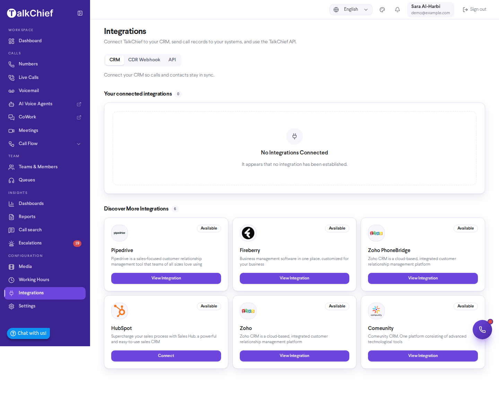
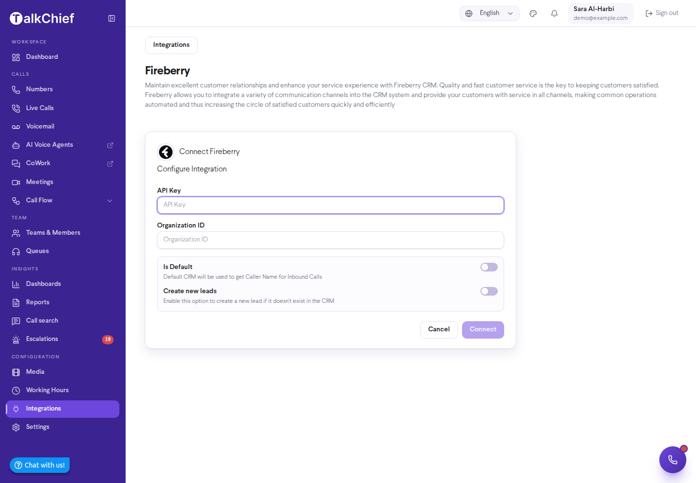

CRM integrations send your TalkChief call activity to the CRM your team already uses. You connect a CRM once, from **Integrations** in the TalkChief web app. Most CRMs connect with a single **Connect** button and your CRM login, with no keys to copy (ActiveCampaign asks for its API URL and key). Each finished call then appears on the matching record with its outcome, talk time, agent and a link to the recording.

## What CRM integrations do

- **Send call activity to your CRM**: while a CRM is connected and switched on, TalkChief sends your company's call events to it.
- **Name inbound callers**: the CRM you mark as **Is Default** is used to get the caller's name for inbound calls. Only one CRM can be the default.
- **Create new records**: turn on **Create new leads** (or **Create new Community Members** for Comeunity) to add a record when the caller doesn't exist in the CRM yet.

What each CRM stores, and where it shows the call, depends on the CRM. Test with a real call before you roll an integration out to your team.

## Supported CRMs

Each of these CRMs has its own setup guide: how to connect, what each logged call shows, the settings, and how to disconnect.

<CardGroup cols={2}>
  <Card title="HubSpot" href="/integrations/hubspot">
    Log every call on the matching contact, and call from inside HubSpot.
  </Card>

  <Card title="monday.com" href="/integrations/monday">
    Log calls on a TalkChief Calls board linked to your monday CRM contacts.
  </Card>

  <Card title="Pipedrive" href="/integrations/pipedrive">
    Log every call on the matching person, with the recording.
  </Card>

  <Card title="HighLevel" href="/integrations/gohighlevel">
    Log every call in the contact's conversation, per sub-account.
  </Card>

  <Card title="Zendesk" href="/integrations/zendesk">
    Log calls as tickets, and call from the Zendesk top bar.
  </Card>

  <Card title="ActiveCampaign" href="/integrations/activecampaign">
    Log each call as a note and a tag that can start your automations.
  </Card>
</CardGroup>

### Zoho CRM and Zoho PhoneBridge

TalkChief offers two Zoho connections. **Zoho** sends your call activity to Zoho CRM. **Zoho PhoneBridge** connects TalkChief calling to Zoho CRM member by member: you invite each member, and you can turn click-to-call on or off for each one. For more on what the Zoho integration covers, visit [TalkChief for Zoho](https://talkchief.io/talkchief-for-zoho).

### Fireberry

Connect Fireberry to send your TalkChief call activity to Fireberry. Fireberry requires an **API Key** and an **Organization ID**. Enter both before you select **Connect**.

### Comeunity

Connect Comeunity to send your TalkChief call activity to Comeunity. For this CRM, the new-record option is called **Create new Community Members**.

## Connect a CRM

For the CRMs listed above with their own guide, select **Connect** on the CRM's card and follow that CRM's guide. Usually you sign in to the CRM and approve TalkChief's access; some CRMs first ask for your account address (Zendesk) or an API URL and key (ActiveCampaign). The steps below are for Zoho, Zoho PhoneBridge, Fireberry and Comeunity.

You need a TalkChief admin account. Get the API token or API key from your CRM's settings before you start.

<Steps>
  <Step title="Open Integrations">
    In the TalkChief web app, select **Integrations** under **Configuration** in the sidebar. The page opens on the **CRM** tab. Connected CRMs are under **Your connected integrations**. The rest are under **Discover More Integrations**.
  </Step>
  <Step title="Open the CRM">
    On the CRM's card, select **View Integration**. If the card shows **Upgrade Your Plan**, the CRM is not included in your plan. If it shows **Coming Soon**, it isn't available yet.
  </Step>
  <Step title="Enter the credentials">
    Fill in the fields the form shows for that CRM. Depending on the CRM, this is a **CRM Token**, an **API Key**, or a **CRM Token** and a **Domain**. Fireberry also requires an **Organization ID**. Zoho PhoneBridge asks for no credentials.
  </Step>
  <Step title="Choose the options">
    Turn on **Is Default** if this CRM should name your inbound callers. Turn on **Create new leads** (or **Create new Community Members**) if you want new records for unknown callers. Zoho PhoneBridge has no options here: skip to **Install**.
  </Step>
  <Step title="Connect">
    Select **Connect** (**Install** for Zoho PhoneBridge). If the CRM needs you to approve access, TalkChief sends you to the CRM's sign-in page to finish. Otherwise you see **Integration added successfully**.
  </Step>
  <Step title="Test the integration">
    Make a test call with TalkChief, then check the contact in your CRM to confirm the call arrived.
  </Step>
</Steps>

<Frame>
  
</Frame>

<Frame>
  
</Frame>

## Set up Zoho PhoneBridge members

After you install Zoho PhoneBridge, TalkChief asks you to check your email to complete the Zoho CRM activation. Then manage members from the integration's settings.

<Steps>
  <Step title="Open the settings">
    Under **Your connected integrations**, select **Configure** on the Zoho PhoneBridge card.
  </Step>
  <Step title="Review the members">
    The **User Settings** table lists each member with **Member Name** and **Status**. Members who have no Zoho CRM user show "User was not found in CRM".
  </Step>
  <Step title="Invite or change members">
    Use the action on each row: **Invite** or **Re-invite** sends the invitation, **Disable** turns click-to-call off for an active member, and **Enable** turns it back on.
  </Step>
</Steps>

## Manage a connected CRM

On each card under **Your connected integrations** you can:

- Use the switch to turn the integration on or off.
- Select **Configure** to change the credentials, **Is Default**, or **Create new leads**, then save. For Zoho PhoneBridge, **Configure** opens the member list instead (see [Set up Zoho PhoneBridge members](#set-up-zoho-phonebridge-members)).
- Select **Delete** to remove the integration.

<Note>
  Integration availability depends on your TalkChief plan. If a CRM shows **Upgrade Your Plan**, upgrade in **Settings** > **Plans**, or contact TalkChief support.
</Note>

<Tip>
  To place calls from your own tools or a CRM not listed here, use the [Click-to-Call API](/developers/click-to-call). It starts a TalkChief call from any system that can make an HTTP request.
</Tip>
