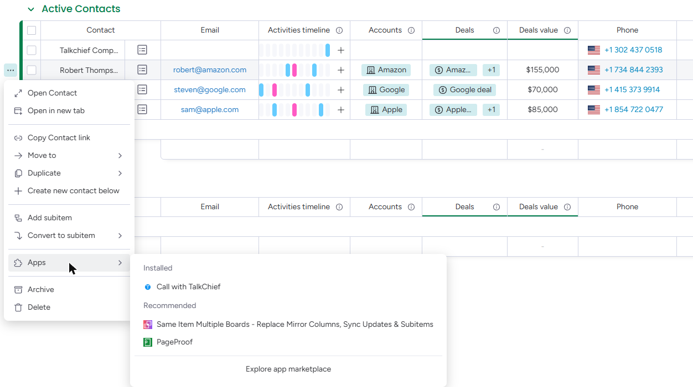
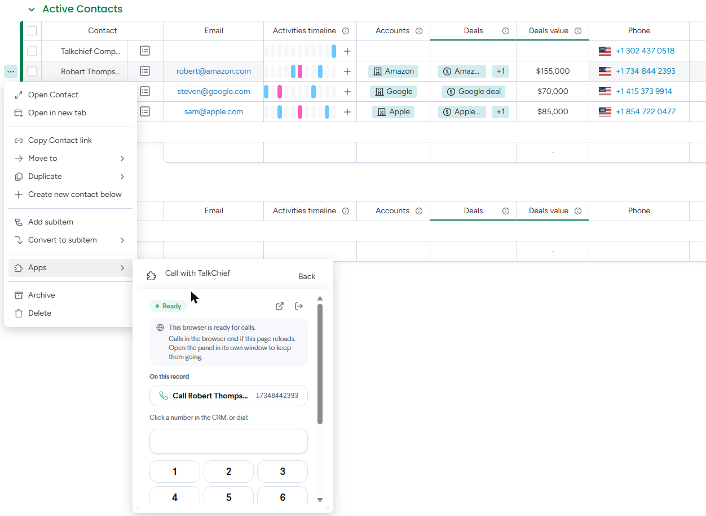

The TalkChief app for monday.com logs every TalkChief phone call in your monday.com account without anyone typing it in. You connect once with your monday.com login, with no API tokens to copy. TalkChief then creates a **TalkChief Calls** board, and each finished call becomes an item on it with its result, talk time, agent and recording, linked to the matching contact or lead in monday CRM.

## What the app does

- **Logs every external call**: inbound and outbound calls become items on the **TalkChief Calls** board. Calls between two TalkChief extensions are not logged.
- **Links the call to the contact or lead**: in monday CRM accounts, TalkChief looks up the caller's number (or the number you dialed) in the phone columns of your **Contacts** board, then your **Leads** board (up to three phone columns each, such as Phone and Mobile), and links the call item to the match.
- **Creates leads for new numbers, if you want**: with **Create contacts for new numbers** on, a number no contact or lead has gets a new lead on your **Leads** board with the number and the caller ID name (a contact on your **Contacts** board if you have no **Leads** board). It is off for new connections.
- **Adds the call to the timeline**: in monday CRM accounts, each linked call also appears on the contact's or lead's **Emails & Activities** timeline as a **TalkChief call** activity.
- **Shows the agent**: the call's **Agent** column is set to the monday.com user whose email matches the TalkChief agent's email. When the agent has no monday.com user, it shows the contact's or lead's owner, or else the monday.com user who connected TalkChief.
- **Keeps the agent's note**: after a call made or taken with the **TalkChief** tab, the agent can add a note and pick an outcome; they appear on the call's item.
- **Adds the recording**: when the call was recorded, the item links to the recording.
- **Calls from inside monday.com**: open a contact or lead, add the **TalkChief** tab and click **Call**. TalkChief rings your TalkChief phone first, then dials, and the call is linked to that contact or lead. See [Call from monday](#call-from-monday).

### The TalkChief Calls board

When you connect, TalkChief creates the **TalkChief Calls** board in your account. In monday CRM accounts it goes in your CRM workspace. Each call is one item:

| Column | What TalkChief puts there |
| --- | --- |
| Item name | **Inbound call from** or **Outbound call to**, followed by the other party's number |
| Result | **Answered**, **Voicemail**, **Busy**, **No answer**, **Missed** or **Failed** |
| Direction | **Inbound** or **Outbound** |
| Phone number | The other party's number |
| Call time | When the call started |
| Talk time (sec) | Talk time in seconds |
| Agent | The agent's monday.com user, when their emails match; otherwise the contact's or lead's owner, or the monday.com user who connected TalkChief |
| Agent name | The agent's name and extension in TalkChief |
| Recording | A **Play recording** link, when the call was recorded |
| Call ID | TalkChief's ID for the call, for support requests |
| Agent outcome | The outcome the agent picked after the call: **Connected**, **Left voicemail**, **No answer**, **Busy** or **Wrong number** (empty when the agent kept the automatic result) |
| Agent note | The note the agent added after the call |
| Contact | The matching contact on your **Contacts** board (monday CRM accounts only) |
| Lead | The matching or new lead on your **Leads** board (monday CRM accounts only) |

You can rename the board, its columns and its labels, move the board, and add your own columns. If you delete the board or one of its columns, TalkChief creates it again with the next call.

### The timeline entry

In monday CRM accounts, a call linked to a contact or lead also appears on its **Emails & Activities** timeline. The entry shows the same title as the item, the result, talk time and agent, the phone number, a link to the recording when there is one, and **Logged by TalkChief**.

Calls usually appear in monday.com within a few minutes of hanging up.

## Before you start

- You are a **company admin** in TalkChief.
- In monday.com, the TalkChief app must be installed in the account you connect. If you are an account admin and the app is not installed yet, monday.com asks you to install it while you connect. Otherwise, ask an account admin to install it first.
- To link calls to contacts and leads and add timeline entries, the account needs **monday CRM** with a **Contacts** board and a **Leads** board that each have a phone column. Without monday CRM, calls are still logged on the **TalkChief Calls** board.
- One monday.com account can be connected to one TalkChief company.

## Connect monday.com

<Steps>
  <Step title="Open Integrations in TalkChief">
    In the TalkChief web app, select **Integrations** under **Configuration** in the sidebar. The page opens on the **CRM** tab.
  </Step>
  <Step title="Start the connection">
    On the **monday.com** card, select **Connect**. TalkChief sends you to monday.com.
  </Step>
  <Step title="Sign in to monday.com and choose the account">
    Sign in with your monday.com login. If you belong to more than one monday.com account, choose the one to connect. If the TalkChief app is not installed in that account yet, monday.com takes you through installing it first (account admins only).
  </Step>
  <Step title="Approve access">
    monday.com shows the access TalkChief asks for (see [Data TalkChief uses in monday](#data-talkchief-uses-in-monday)). Approve it.
  </Step>
  <Step title="Confirm in TalkChief">
    monday.com sends you back to **Integrations** in TalkChief. A message confirms that monday.com is connected, and the card moves to your connected integrations with a **Connected** label. The **TalkChief Calls** board appears in your monday.com account.
  </Step>
  <Step title="Test with a real call">
    Make or receive a call with TalkChief. A few minutes after you hang up, open the **TalkChief Calls** board and check that the call is there. In monday CRM, also open the contact or lead and check its **Emails & Activities** timeline.
  </Step>
</Steps>

## Choose what gets logged

On the connected monday.com card in **Integrations**, select the settings (gear) icon. The settings window shows the connected monday.com account and three switches you can change at any time. Each change applies to calls that end afterwards.

**Log calls** and **Log missed calls** are on by default. **Create contacts for new numbers** is off by default for new connections.

| Setting | On | Off |
| --- | --- | --- |
| **Log calls** | Every external call is logged | Nothing is logged, and the connection stays in place |
| **Log missed calls** | Busy, unanswered, cancelled and voicemail calls are logged too | Only answered calls are logged |
| **Create contacts for new numbers** | Unknown numbers get a new lead on your **Leads** board (a contact if you have no **Leads** board) | Calls from unknown numbers are logged without a contact or lead |

## Call from monday

The TalkChief calling panel lets each agent place TalkChief calls from monday.com. You open it from any contact or lead, and the call is logged on that item.

<Note>
  Clicking a phone number in monday.com doesn't call through TalkChief. monday.com uses that click for its own calling: it offers the monday.com mobile app, or opens your computer's default calling app. Use **Call with TalkChief** instead.
</Note>

<Steps>
  <Step title="Open Call with TalkChief">
    On your **Contacts** or **Leads** board, hover over the contact or lead and select the three dots (**⋯**) to the left of its name. Choose **Apps**, then **Call with TalkChief**. If you don't see it, reload the page.

    <Frame>
      
    </Frame>
  </Step>
  <Step title="Sign in to TalkChief">
    The TalkChief panel opens in a small window. Select **Sign in to TalkChief**. A TalkChief window opens; sign in if asked, and it closes by itself when you are connected. Each agent signs in once on their own computer. Signing in here doesn't sign you out of the TalkChief web app or your TalkChief apps.
  </Step>
  <Step title="Place a call">
    Under **On this record**, select **Call** with the contact's name and number, or type any number on the dial pad.

    <Frame>
      
    </Frame>

    When the panel says **This browser is ready for calls**, the call runs in your browser, so allow the microphone when your browser asks. The small window closes when you click elsewhere in monday.com, and a call in it ends. Before you call, select the open-in-new-window icon at the top of the panel, and place the call from that window. Otherwise TalkChief rings your TalkChief phone (the TalkChief app or your desk phone) first. Answer it, and TalkChief dials the number.
  </Step>
</Steps>

A call placed from a contact or lead is logged on that contact or lead, with the same details as every other logged call: result, talk time, agent and recording.

When the call ends, the panel lets you add a note and pick an outcome. They go into the call's **Agent note** and **Agent outcome** columns. Saving again replaces them, and clearing them puts the call back to its automatic result.

You can also keep the panel on a contact or lead as a tab: open the item, click **\+** in the tab bar under its name and choose **TalkChief**.

<Note>
  monday.com can't open a record by itself when a call comes in. Incoming calls still ring your TalkChief phone as usual, and they are logged on the matching contact or lead after the call. While the panel is open, it also shows the incoming call and lets you open the caller's record.
</Note>

## Data TalkChief uses in monday

When you connect, you allow TalkChief to:

| Access | Why |
| --- | --- |
| Read your profile and account information | Identify the monday.com account you connected and find your monday CRM workspace |
| Read boards | Find your **Contacts** and **Leads** boards and the contact or lead whose phone number matches the call |
| Change boards | Create the **TalkChief Calls** board and its columns, add each call, add leads for new numbers (only while **Create contacts for new numbers** is on) and add timeline entries |
| Read users | Match the TalkChief agent to their monday.com user by email |

TalkChief writes calls, new leads and timeline entries. It does not change your other boards or items, and it does not copy your monday.com data into TalkChief.

<Note>
  monday.com limits how many API requests apps outside its marketplace can make for each account per day: 200 on Free, 1,000 on Standard and Basic, 10,000 on Pro and 25,000 on Enterprise plans. Each logged call uses about three or four requests. When your account reaches the limit, TalkChief keeps the calls and logs them after the limit resets at midnight UTC.
</Note>

## Disconnect monday.com

To stop logging calls and remove TalkChief's access, open **Integrations** in TalkChief and select the trash icon on the monday.com card (or **Disconnect** in its settings window), then confirm.

When you disconnect:

- Calls are no longer logged in monday.com. Calls that were waiting to be logged are dropped.
- TalkChief revokes its access to your monday.com account.
- The **TalkChief Calls** board, the calls on it, leads TalkChief created and timeline entries stay in monday.com. Nothing is deleted from monday.com.

You can connect again at any time. If you reconnect the same monday.com account, TalkChief keeps using the same **TalkChief Calls** board.

## Remove the app from monday.com

You can also remove the TalkChief app from your monday.com account. After that, calls stop being logged and the monday.com card in TalkChief shows **Reconnect needed**. Everything already in monday.com stays there. To remove the connection from TalkChief too, disconnect it on the monday.com card.

## Troubleshooting

<AccordionGroup>
  <Accordion title="The monday.com card asks me to reconnect">
    The card shows **Reconnect needed** when TalkChief lost access to monday.com, usually because the app was removed from the account or its access was revoked. Select **Reconnect** and approve access again. Calls that ended in the meantime are logged once you reconnect, as long as you reconnect within 7 days.
  </Accordion>

  <Accordion title="I cancelled on the monday.com screen, or connecting did not finish">
    Nothing was connected. Select **Connect** on the monday.com card again. If monday.com asks you to install the app and you are not an account admin, ask an admin to install the TalkChief app first.
  </Accordion>

  <Accordion title="This monday.com account is already connected to another company">
    A monday.com account can be connected to only one TalkChief company, so that each company's calls stay in its own account. Disconnect it from the other TalkChief company first, or connect a different monday.com account.
  </Accordion>

  <Accordion title="Calls are not linked to a contact or lead and there is no timeline entry">
    Linking and timeline entries need monday CRM with a **Contacts** board and a **Leads** board that have a phone column, found when you connected. Check that the contact or lead has the caller's number in one of the board's first three phone columns. If **Create contacts for new numbers** is off, calls from unknown numbers are logged without a contact or lead. If monday.com could not search your boards for a call, TalkChief logs it without a link and does not create a lead, so nobody is added twice. If you added monday CRM after connecting, contact TalkChief support.
  </Accordion>

  <Accordion title="A call has no agent">
    The **Agent** column shows the agent's monday.com user only when the agent's TalkChief email matches a monday.com user's email; otherwise it shows the contact's or lead's owner, or the monday.com user who connected TalkChief. Use the same email in both, or invite the agent to your monday.com account. The **Agent name** column always shows the TalkChief agent.
  </Accordion>

  <Accordion title="The phone number column is empty">
    monday.com accepts only numbers it considers valid for their country. For other numbers, TalkChief leaves the column empty; the number is still in the item name.
  </Accordion>

  <Accordion title="Calls arrive late or stop for the rest of the day">
    Your monday.com account may have reached its daily API limit (see [Data TalkChief uses in monday](#data-talkchief-uses-in-monday)). The calls are kept and logged after the limit resets at midnight UTC.
  </Accordion>

  <Accordion title="The TalkChief tab says my TalkChief phone is offline">
    TalkChief rings your own TalkChief phone first, so it must be registered: open the TalkChief app on your computer or phone, or check that your desk phone is connected, then try again.
  </Accordion>

  <Accordion title="The TalkChief tab asks me to sign in again">
    Your TalkChief sign-in in the tab lasts 30 days and renews itself while you use it. If it ran out or was signed out, select **Sign in to TalkChief** to continue.
  </Accordion>

  <Accordion title="A recording does not play">
    The recording link is added only when the call was recorded. Check that call recording is on for that number or team in TalkChief.
  </Accordion>
</AccordionGroup>

For anything else, contact TalkChief support at [support@talkchief.io](mailto:support@talkchief.io).
