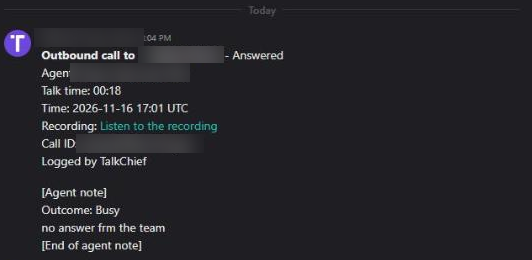
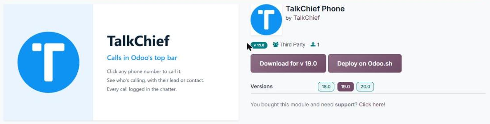
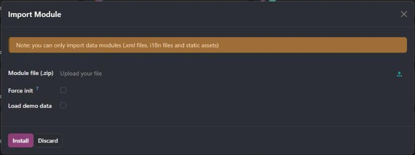
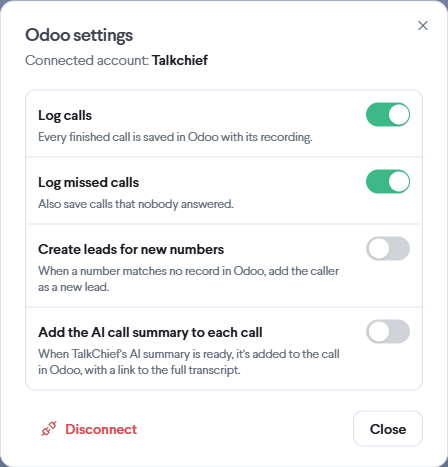
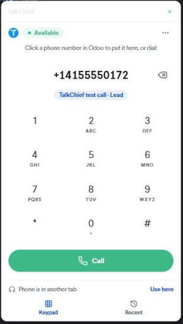
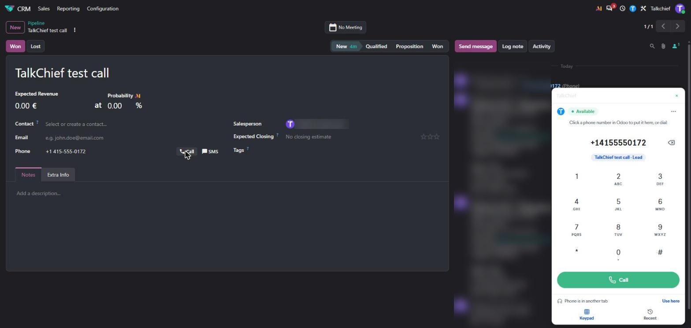

The TalkChief integration for Odoo CRM does two things:

- **Logs every call in Odoo.** Each finished TalkChief call is added as a note in the chatter of the matching Odoo lead, opportunity or contact, with the result, the agent, talk time and a link to the recording.
- **Puts TalkChief in Odoo's top bar.** With the TalkChief app installed in Odoo, agents click a phone number in Odoo, check it in the TalkChief panel and select **Call**. Incoming calls show the caller and their lead or contact in the same panel.

This guide is for **Odoo Online** databases (`yourcompany.odoo.com`), version 18, 19 or 20.

## What the integration does

- **Logs every external call**: inbound and outbound calls are added as a note in the record's chatter. Calls between two TalkChief extensions are not logged.
- **Finds the right record**: TalkChief looks for an open lead or opportunity with exactly the caller's number (or the number you dialed), then for a contact. Formats such as `+15551234567`, `+1 555-123-4567` and a local number in the caller's country match.
- **Shows who handled the call**: the note's author is the agent's Odoo user when their email matches their TalkChief email, otherwise the record's salesperson, otherwise the Odoo user whose API key you connected.
- **Can create leads for new numbers**: when you turn on **Create leads for new numbers**, TalkChief creates a lead with the number and the caller ID name, assigned to the agent. It is off for new connections.
- **Links the recording**: when the call was recorded, the note links to the recording.
- **Adds the agent's note and outcome**: after a call, the agent can add a note and an outcome in the TalkChief panel. They're added to the same call note.
- **Adds the AI call summary, if you want**: with [AI transcription](/ai/ai-transcription) on, TalkChief can add the call's AI summary to the same note once it's ready, with a link to the full transcript. This is off until you turn it on.
- **Calls from Odoo's top bar**: click a phone number in Odoo and it goes into the TalkChief dial pad. Make and answer calls through your computer or your TalkChief phone. See [Call from Odoo](#call-from-odoo).

Each logged call looks like this in the chatter:

<Frame caption="A call logged by TalkChief, with the agent's note and outcome">
  
</Frame>

| In the note | What it shows |
| --- | --- |
| First line | **Inbound call from** or **Outbound call to**, the other party's number, and the result (Answered, No answer, Busy, Voicemail and so on) |
| Agent | The agent's name and extension |
| Talk time and Time | How long the call lasted, and when it started (UTC) |
| Recording | **Listen to the recording**, when the call was recorded |
| Call ID | TalkChief's reference for the call |
| Agent note | The note and outcome the agent added after the call |
| AI summary | The call's AI summary, when you turn it on |

Calls usually appear in Odoo within a minute or two of hanging up.

## Before you start

- You are a **company admin** in TalkChief.
- Your Odoo database runs on **Odoo Online** (`yourcompany.odoo.com`), version 18 or later, with the **CRM** app.
- You can sign in to Odoo as an **administrator**. You need it to install the TalkChief app and to create an API key that doesn't expire.
- Each agent who calls from Odoo has a TalkChief phone line.
- One Odoo database can be connected to one TalkChief company.

<Note>
  Call logging uses Odoo's external API. Odoo's documentation lists API access under its **Custom** plan, so depending on your plan it may not be available. If Odoo refuses API access when you connect, TalkChief says **Odoo refused API access**; check your Odoo plan, then connect again.
</Note>

## Install the TalkChief app in Odoo

The TalkChief app adds TalkChief to Odoo's top bar. It's free, contains no Python code and stores nothing in Odoo.

<Steps>
  <Step title="Find TalkChief in the Odoo Apps store">
    Open [TalkChief Phone on apps.odoo.com](https://apps.odoo.com/apps/modules/20.0/talkchief_phone). Under **Versions**, choose your Odoo version (**18.0**, **19.0** or **20.0**; Odoo shows yours in **Settings**, at the bottom of the page), then select **Download for v …**. You get a zip file.

    <Frame>
      
    </Frame>
  </Step>
  <Step title="Turn on developer mode in Odoo">
    In Odoo, open **Settings**, scroll to the bottom and select **Activate the developer mode**.
  </Step>
  <Step title="Import the app">
    Open **Apps** and select **Import Module** in the top menu. Choose the zip file you downloaded, leave **Force init** and **Load demo data** unticked, and select **Install**.

    <Frame>
      
    </Frame>
  </Step>
  <Step title="Reload Odoo">
    Reload the page. The TalkChief icon appears in Odoo's top bar, for every user of the database.
  </Step>
</Steps>

<Note>
  **Odoo.sh and on-premise:** TalkChief currently works with Odoo Online databases (`yourcompany.odoo.com`) only, for both call logging and the top-bar panel.
</Note>

To update the app later, download the new version from the store and import it the same way (leave **Force init** unticked).

## Connect Odoo in TalkChief

### Create an API key in Odoo

<Steps>
  <Step title="Open your preferences">
    Sign in to Odoo as an administrator, select your avatar in the top right, then **Preferences** (or **My Preferences**).
  </Step>
  <Step title="Create the key">
    Open the **Account Security** tab and select **New API Key**. Odoo asks for your password. Enter a description such as "TalkChief". If Odoo asks for a scope, choose **RPC**. Choose **Persistent Key** as the duration, so the key doesn't expire.
  </Step>
  <Step title="Copy the key">
    Copy the key Odoo shows. Odoo shows it only once. You don't need to keep it anywhere else: paste it into TalkChief in the next step.
  </Step>
</Steps>

<Warning>
  Keys of users who are not administrators expire after at most 3 months. When a key expires, the Odoo card in TalkChief asks you to reconnect with a new key.
</Warning>

### Connect Odoo

<Steps>
  <Step title="Open Integrations in TalkChief">
    In the TalkChief web app, select **Integrations** under **Configuration** in the sidebar. The page opens on the **CRM** tab.
  </Step>
  <Step title="Start the connection">
    On the **Odoo** card, select **Connect**.
  </Step>
  <Step title="Enter your Odoo address and key">
    Enter your **Odoo address** (for example `yourcompany.odoo.com`; you can paste the address from your browser) and paste the **API key**, then select **Connect**.
  </Step>
  <Step title="Odoo 18 only: enter the login">
    If your database runs Odoo 18, TalkChief also asks for the **login** (the email) of the user who created the key. Enter it and select **Connect** again. Odoo 19 and later don't need it.
  </Step>
  <Step title="Check the connection">
    The Odoo card moves to your connected integrations with a **Connected** label.
  </Step>
</Steps>

TalkChief stores the API key encrypted and uses it only to log calls and find callers in Odoo.

## Choose what gets logged

On the connected Odoo card in **Integrations**, select the settings (gear) icon. The **Odoo settings** window shows the connected account and switches you can change at any time. Each change applies to calls that end afterwards.

<Frame>
  
</Frame>

| Setting | New connections | On | Off |
| --- | --- | --- | --- |
| **Log calls** | On | Every external call is logged | Nothing is logged, and the connection stays in place |
| **Log missed calls** | On | Busy, unanswered, cancelled and voicemail calls are logged too | Only answered calls are logged |
| **Create leads for new numbers** | Off | Unknown numbers get a new lead, assigned to the agent | Calls from numbers Odoo doesn't have are not logged, because Odoo keeps notes only on a record |
| **Add the AI call summary to each call** | Off | When a call's AI summary is ready, it's added to the call's note with a link to the full transcript | Notes have no summary |

**Add the AI call summary to each call** needs [AI transcription](/ai/ai-transcription). Without it, the switch is locked and says what's missing.

## Call from Odoo

The TalkChief panel opens from Odoo's top bar, so each agent can make and answer TalkChief calls without leaving Odoo.

<Steps>
  <Step title="Open TalkChief from the top bar">
    In Odoo, select the TalkChief icon in the top bar. The TalkChief panel opens in the corner of the page. Until someone opens it once in a browser, the app does nothing there.

    <Frame>
      
    </Frame>
  </Step>
  <Step title="Sign in to TalkChief">
    Select **Sign in** and sign in with your TalkChief account in the window that opens. Each agent signs in once on their own computer.
  </Step>
  <Step title="Choose where calls ring">
    Open the panel's menu (**⋯**) and, under **Calls ring**, choose **This browser** to talk through your computer, or **My TalkChief phone** to use your desk phone or the TalkChief app. With **This browser**, allow the microphone when your browser asks.
  </Step>
  <Step title="Place a call">
    On a lead, opportunity or contact, select **Call** next to the phone number (Odoo 20), or select the phone number itself (Odoo 18 and 19). The number goes into the TalkChief dial pad, with the matching record under it. Check it and select **Call** in the panel. Odoo never places a call by itself.

    <Frame>
      
    </Frame>
  </Step>
  <Step title="Receive a call">
    When a call comes in, the panel shows the caller and, when Odoo has their number, their lead or contact. Answer in the panel or on your TalkChief phone. Select **Open record** to see the record in Odoo; your Odoo page doesn't change by itself, so nothing you were editing is lost.
  </Step>
  <Step title="Add a note and an outcome">
    When the call ends, type a note and pick an outcome in the panel. They are added to the call's note in the chatter.
  </Step>
</Steps>

<Note>
  The panel works while Odoo is open in a browser tab. You can hide it with **×** and calls still come in. If the panel is hidden when a call comes in, you hear it ring (with **This browser**) or your TalkChief phone rings; open the panel to see the caller. The panel works only in the Odoo database your TalkChief company is connected to.
</Note>

## Data TalkChief uses in Odoo

With your API key, TalkChief:

| Access | Why |
| --- | --- |
| Reads leads, opportunities and contacts | Find the record whose phone number matches the call, for the note and for the caller in the panel |
| Reads users | Show the agent as the note's author |
| Creates leads | Create a lead for a number Odoo doesn't have (only while **Create leads for new numbers** is on) |
| Posts and updates notes | Log each call in the record's chatter, and add the agent's note and the AI call summary to that note. TalkChief changes only the notes it wrote |

The TalkChief app in Odoo sends the TalkChief panel only the phone numbers you click, and the panel tells Odoo only which lead or contact to open when you select **Open record**. TalkChief doesn't change your leads' stages, values or other fields, and it doesn't copy your Odoo records into TalkChief.

## Disconnect Odoo

To stop logging calls, open **Integrations** in TalkChief and select the trash icon on the Odoo card (or **Disconnect** in the **Odoo settings** window), then confirm.

When you disconnect:

- Calls are no longer logged in Odoo. Calls that were waiting to be logged are dropped.
- TalkChief deletes the API key it stored.
- Notes and leads already in Odoo stay there. Nothing is deleted from Odoo.

The key itself keeps working in Odoo until you delete it: in Odoo, open **Preferences** > **Account Security** and delete the TalkChief key.

## Uninstall the app from Odoo

To remove TalkChief from Odoo's top bar, open **Apps** in Odoo, search for **TalkChief Phone** (remove the **Apps** filter in the search bar), open it and select **Uninstall**. Uninstalling the app doesn't disconnect call logging; disconnect in TalkChief as well if you want logging to stop.

## Troubleshooting

<AccordionGroup>
  <Accordion title="This is not an Odoo address">
    Enter the address of your Odoo Online database, such as `yourcompany.odoo.com`. Databases hosted on Odoo.sh or on your own servers are not supported yet.
  </Accordion>

  <Accordion title="Odoo did not accept this API key">
    Create a new key in **Preferences** > **Account Security** (scope **RPC** if Odoo asks) and try again.
  </Accordion>

  <Accordion title="Odoo refused API access">
    Odoo refused TalkChief's request to its external API. Odoo lists API access under its Custom plan, so check your Odoo plan, then connect again with your API key.
  </Accordion>

  <Accordion title="This Odoo version is not supported">
    TalkChief works with Odoo 18 and later. Odoo upgrades Odoo Online databases regularly; connect again after your database is upgraded.
  </Accordion>

  <Accordion title="The Odoo card asks me to reconnect">
    Odoo no longer accepts the API key, usually because it expired or was deleted. Create a new key (choose **Persistent Key** as an administrator) and select **Reconnect**. Calls that ended in the meantime are logged once you reconnect, as long as you reconnect within 7 days.
  </Accordion>

  <Accordion title="Calls cannot be logged because of the key user's rights">
    The user whose key you connected may not read or update leads and contacts. Give that user **Sales: All Documents** and **Contacts: Creation**, or connect with an administrator's key.
  </Accordion>

  <Accordion title="A call is not on the lead or contact">
    TalkChief matches the record by its **Phone** field (and **Mobile** on Odoo 18), and only an exact match counts. Check that the record has the caller's number there, preferably with its country code. Won and lost leads are skipped. If **Create leads for new numbers** is off, calls from numbers Odoo doesn't have are not logged.
  </Accordion>

  <Accordion title="There is no TalkChief icon in Odoo's top bar">
    Install the TalkChief app (see [Install the TalkChief app in Odoo](#install-the-talkchief-app-in-odoo)), then reload the page.
  </Accordion>

  <Accordion title="Odoo shows an error when I select the TalkChief icon">
    Install the latest version of the app from the Odoo Apps store: download it and import it again (leave **Force init** unticked), then reload Odoo.
  </Accordion>

  <Accordion title="Clicking a number in Odoo does nothing">
    Open TalkChief from the top bar once in this browser; until then the app leaves phone numbers to Odoo. Numbers with an extension (such as `;ext=12`) are left to your browser; type them in the panel instead.
  </Accordion>

  <Accordion title="The panel shows Wrong account">
    You are signed in to a TalkChief company that is connected to a different Odoo database, so the panel doesn't place or show calls. Open the panel's menu (**⋯**), sign out, and sign in with the TalkChief company connected to this database.
  </Accordion>

  <Accordion title="The microphone is blocked">
    Allow the microphone for `app.talkchief.io` in your browser, or open the panel's menu (**⋯**) and select **Open in its own window**. Calls then ring in that window.
  </Accordion>

  <Accordion title="A call has no recording link">
    The recording link is added only when the call was recorded. Check that call recording is on for that number or team in TalkChief.
  </Accordion>
</AccordionGroup>

For anything else, contact TalkChief support at [support@talkchief.io](mailto:support@talkchief.io).
