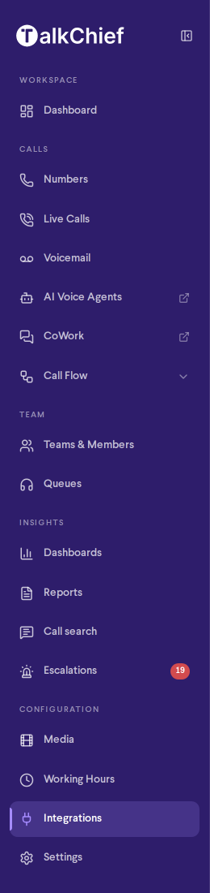
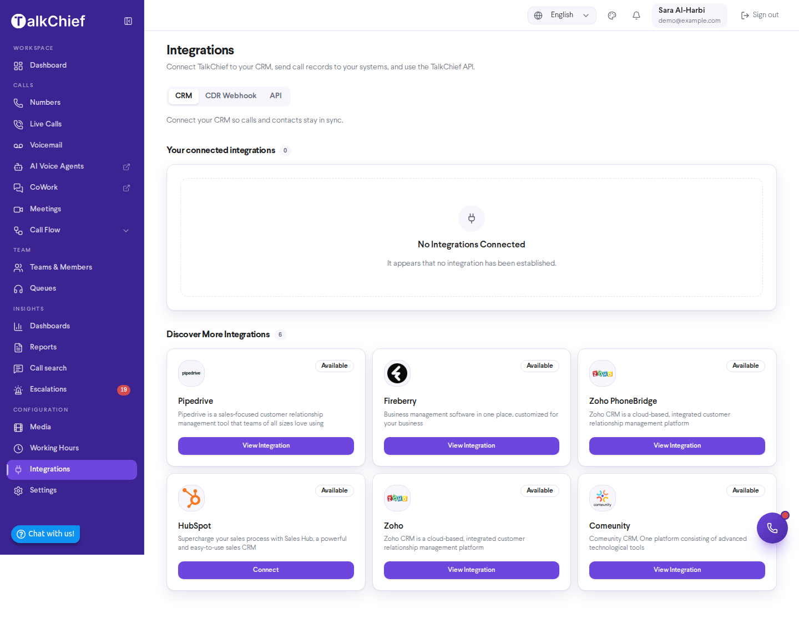

Integrations bridge your TalkChief calling activity and your existing business software, so call logs, contact data, and outcomes flow automatically into the tools your teams rely on every day. Whether you run sales in HubSpot or Pipedrive or manage customers in Zoho, TalkChief integrations remove the manual work of copying information between systems and give every team member the full call context they need.

## Where to find integrations

Everything that connects TalkChief to other systems is in one place: **Integrations** under **Configuration** in the sidebar. Only company admins see it. The page has three tabs:

- **CRM**: connect HubSpot, monday.com, Pipedrive, HighLevel, Zendesk, ActiveCampaign, Zoho, Zoho PhoneBridge, Fireberry and Comeunity. See [CRM integrations](/integrations/crm-integrations).
- **CDR Webhook**: send a record of every completed call to up to 10 endpoints. See [CDR webhook](/developers/webhooks).
- **API**: your Company ID, base URL and API keys, plus the Click-to-Call, AI Transcription and OpenAPI references. See [Developer APIs](/developers/overview).

<Note>
  Click-to-Call, AI Transcription and the CDR webhook used to be under **Settings** > **Integrations**. They moved to **Integrations**, and old links to the Settings page open the **API** tab.
</Note>

<Frame>
  
</Frame>

<Frame>
  
</Frame>

## Available Integrations

<CardGroup cols={2}>
  <Card title="HubSpot" icon="hubspot" href="/integrations/hubspot">
    Log every call on the matching contact, and call from inside HubSpot.
  </Card>
  <Card title="monday.com" icon="table-columns" href="/integrations/monday">
    Log calls on a TalkChief Calls board linked to your monday CRM contacts.
  </Card>
  <Card title="Pipedrive" icon="chart-line" href="/integrations/pipedrive">
    Log every call on the matching person, with the recording.
  </Card>
  <Card title="HighLevel" icon="layer-group" href="/integrations/gohighlevel">
    Log every call in the contact's conversation, per sub-account.
  </Card>
  <Card title="Zendesk" icon="headset" href="/integrations/zendesk">
    Log calls as tickets, and call from the Zendesk top bar.
  </Card>
  <Card title="ActiveCampaign" icon="bolt" href="/integrations/activecampaign">
    Log each call as a note and a tag that can start your automations.
  </Card>
  <Card title="Zoho CRM" icon="database" href="/integrations/crm-integrations#zoho-crm-and-zoho-phonebridge">
    Connect Zoho CRM, or use Zoho PhoneBridge to place and receive TalkChief calls inside Zoho.
  </Card>
  <Card title="Fireberry" icon="link" href="/integrations/crm-integrations#fireberry">
    Keep Fireberry customer records and call activity in sync with TalkChief.
  </Card>
  <Card title="Comeunity" icon="users" href="/integrations/crm-integrations#comeunity">
    Sync TalkChief call activity with your Comeunity CRM records.
  </Card>
</CardGroup>

## Custom Integrations

TalkChief has delivered customer-specific ecosystem integrations for organizations that need calling embedded directly into their own internal platforms or bespoke toolchains. These engagements go beyond the standard catalog above and are scoped individually for each customer.

A custom integration engagement follows a structured process: a discovery conversation to understand your requirements, a feasibility and technical review, a security and data handling review, and a commercial agreement before any build work begins. This process ensures the resulting integration is secure, supportable, and aligned with your architecture.

Custom integrations are not automatic entitlements under any TalkChief plan. To explore whether a custom integration is right for your organization, contact the TalkChief sales team to start a discovery conversation.

## Developer Integration

If you need programmatic or trigger-based calling — for example, initiating calls from a script, a webhook, or an internal tool — TalkChief exposes a developer API. Start with the [Developers Overview](/developers/overview) for a summary of what is available, then see the [REST API reference](/developers/rest-api) for endpoint details and authentication.

<Note>
  Integration actions and feature availability vary by TalkChief plan and account configuration. If a feature described in these pages is not visible in your account, check your plan or contact your TalkChief administrator.
</Note>
