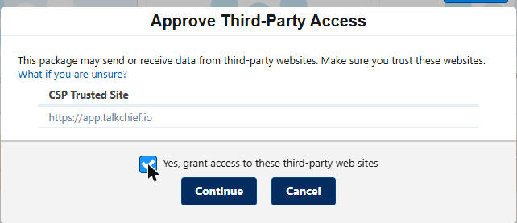
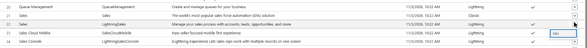
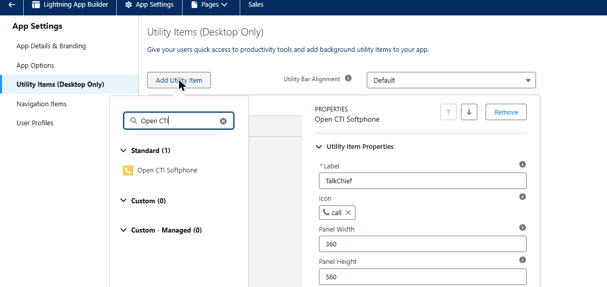
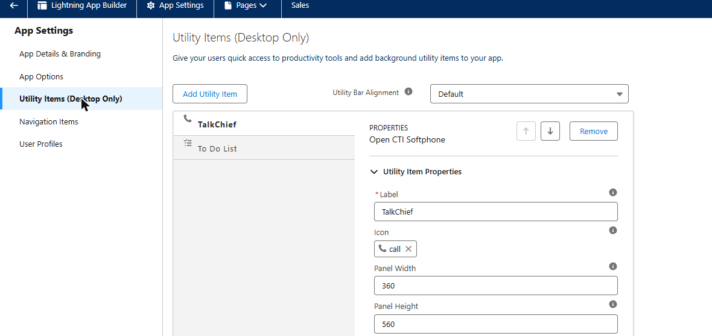
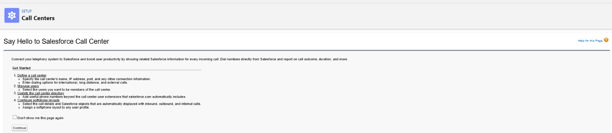
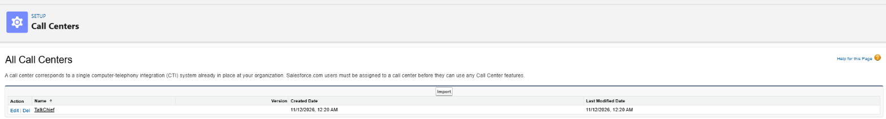
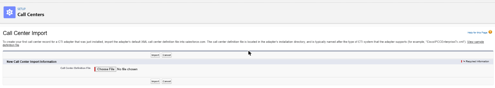
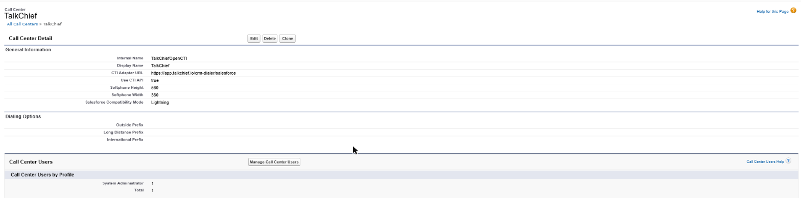
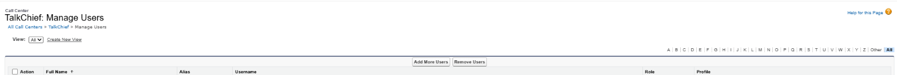

TalkChief for Salesforce logs every TalkChief phone call in your Salesforce org without anyone typing it in. A Salesforce admin installs the TalkChief app once and connects it with their Salesforce login, with no API keys or tokens to copy. From then on, each finished call appears as a completed call task on the matching contact or lead, with its result, talk time, the agent who handled it and a link to the recording.

## What the integration does

- **Logs every external call as a task**: inbound and outbound calls are logged as completed Salesforce tasks of type call. Calls between two TalkChief extensions are not logged.
- **Finds the right contact or lead**: TalkChief searches the phone fields of your contacts (**Phone**, **Mobile**, **Home Phone**, **Other Phone**) and of your leads that are not converted yet (**Phone**, **Mobile**), in any format. When both a contact and a lead have the number, the contact wins. When several records match, the most recently updated one is used.
- **Creates leads for new numbers, if you want**: when no contact or lead has the number, TalkChief can create a lead for the caller. This is off until you turn it on; while it is off, the call is logged as a task without a contact or lead.
- **Assigns the task to the agent**: the task is assigned to the active Salesforce user whose email matches the TalkChief agent's email. When the agent has no Salesforce user, it goes to the owner of the matching contact or lead, and otherwise to the user who connected TalkChief.
- **Adds the recording**: when the call was recorded, the task's comments include a link to the recording.
- **Adds the AI call summary, if you want**: with [AI transcription](/ai/ai-transcription) on, TalkChief can add the call's AI summary to the same task's comments once it's ready, with a link to the full transcript. This is off until you turn it on (see [Choose what gets logged](#choose-what-gets-logged)).
- **Calls from inside Salesforce**: with the TalkChief softphone in your Lightning app's utility bar, click a phone number in Salesforce and TalkChief places the call through your TalkChief phone. Incoming calls open the caller's record. See [Call from Salesforce](#call-from-salesforce).

Each logged call shows:

| Salesforce task field | What TalkChief puts there |
| --- | --- |
| Subject | **Call with**, followed by the name of the matching contact or lead, or the other party's number when no named record matches |
| Task subtype | Call |
| Call Type | Inbound or Outbound |
| Call Duration | Talk time, in seconds |
| Call Result | **Connected**, **Busy**, **No answer**, **Left voicemail**, **Cancelled**, **Abandoned**, **Network busy** or **Failed** |
| Call Object Identifier | The TalkChief call ID |
| Status | Completed |
| Due Date | The day of the call |
| Comments | Status, the agent's name and extension, talk time, the recording link, and **Logged by TalkChief**; later also the agent's note from the softphone and the AI call summary, when they are added |
| Name | The matching contact or lead |
| Assigned To | The agent's Salesforce user, when their emails match; otherwise the contact's or lead's owner, or the user who connected TalkChief |

Calls usually appear in Salesforce within a few minutes of hanging up, under **Activity** on the contact or lead.

<Note>
  If your org doesn't accept the call fields (**Call Type**, **Call Duration**, **Call Result**, **Call Object Identifier**) or uses a different name for the **Completed** status, TalkChief logs the task without them instead of failing, and keeps doing so for your org.
</Note>

## Before you start

- You are a **company admin** in TalkChief.
- You are a **Salesforce admin** in the org you want to connect. TalkChief logs calls with the access of the Salesforce user who connects it, so that user needs to read contacts, leads and users, create tasks and leads, and assign tasks to other users.
- Your Salesforce edition includes API access: Enterprise, Unlimited, Performance and Developer editions do, and Professional Edition does with the API add-on. The user who connects needs the **API Enabled** permission.
- One Salesforce org can be connected to one TalkChief company.

## Install the TalkChief app in Salesforce

Before you connect, a Salesforce admin installs the TalkChief app (a managed package) in your org.

<Steps>
  <Step title="Open the install link">
    Open the [TalkChief install link](https://login.salesforce.com/packaging/installPackage.apexp?p0=04thm000003iHWTAA2) and sign in to Salesforce as an admin of the org you want to connect. For a sandbox, use the same link with `test.salesforce.com` in place of `login.salesforce.com`.
  </Step>
  <Step title="Install for admins only">
    Choose **Install for Admins Only**. Until TalkChief is listed on AppExchange, Salesforce shows a notice that the app is not authorized for distribution through AppExchange: tick **I acknowledge** and select **Install**. Only the admin who connects TalkChief authorizes the app, so no other user needs access to it.
  </Step>
  <Step title="Allow the TalkChief softphone">
    Salesforce asks you to approve third-party access for `https://app.talkchief.io`, the address of the TalkChief softphone. Tick **Yes, grant access to these third-party web sites** and select **Continue**.

    <Frame>
      
    </Frame>
  </Step>
  <Step title="Finish the install">
    When Salesforce shows **Installation Complete!**, select **Done**.
  </Step>
</Steps>

## Connect Salesforce

<Steps>
  <Step title="Open Integrations in TalkChief">
    In the TalkChief web app, select **Integrations** under **Configuration** in the sidebar. The page opens on the **CRM** tab.
  </Step>
  <Step title="Start the connection">
    On the **Salesforce** card, select **Connect**. TalkChief sends you to Salesforce.
  </Step>
  <Step title="Sign in to Salesforce">
    Sign in with your Salesforce admin login for the org where you installed the TalkChief app.
  </Step>
  <Step title="Approve access">
    Salesforce shows the access TalkChief asks for (see [Data TalkChief uses in Salesforce](#data-talkchief-uses-in-salesforce)). Select **Allow**.
  </Step>
  <Step title="Confirm in TalkChief">
    Salesforce sends you back to **Integrations** in TalkChief. A message confirms that Salesforce is connected, and the Salesforce card moves to your connected integrations with a **Connected** label.
  </Step>
  <Step title="Test with a real call">
    Make or receive a call with TalkChief. A few minutes after you hang up, open the contact or lead in Salesforce and check that the call is under **Activity**.
  </Step>
</Steps>

## Choose what gets logged

On the connected Salesforce card in **Integrations**, select the settings (gear) icon. The **Salesforce settings** window shows the connected Salesforce org and switches you can change at any time. Each change applies to calls that end afterwards.

| Setting | Default | On | Off |
| --- | --- | --- | --- |
| **Log calls** | On | Every external call is logged | Nothing is logged, and the connection stays in place |
| **Log missed calls** | On | Busy, unanswered, cancelled and voicemail calls are logged too | Only answered calls are logged |
| **Create leads for new numbers** | Off | A number that matches no contact or lead gets a new Salesforce **lead** | Calls from unknown numbers are logged as tasks without a contact or lead |
| **Add the AI call summary to each call** | Off | When a call's AI summary is ready, it's added to the task's comments with a link to the full transcript | Tasks have no summary |

**Add the AI call summary to each call** needs [AI transcription](/ai/ai-transcription). While your company doesn't have it, the switch is shown locked with **Needs AI transcription.** and a **Turn it on** link to **Settings** > **AI transcription**. If your plan doesn't include AI transcription, it shows **Needs a plan with AI transcription.** and a **See plans** link instead.

With the switch on, the summary appears in the **Comments** of the call's task, under **Activity** on the contact or lead, after the call has been transcribed:

```text
[AI summary]
The customer asked to move their delivery to Friday. The agent confirmed the new date and will send a confirmation email.

Full transcript in TalkChief: https://...
[End of AI summary]
```

The summary is added only to calls that AI transcription covers. If a summary is created again, TalkChief replaces its earlier summary in the comments instead of adding a second one. The agent's note from the softphone and anything else in the comments stay as they are. Salesforce allows up to 32,000 characters in a task's comments; when the summary would go past that, TalkChief shortens it to fit.

A lead that TalkChief creates has:

| Lead field | Value |
| --- | --- |
| Last Name | The caller ID name, or the phone number when there is no name |
| Company | Unknown (TalkChief caller) |
| Phone | The caller's number |
| Lead Owner | The agent's Salesforce user, when their emails match |
| Description | Created by TalkChief for a caller not found in Salesforce |

Salesforce's search finds new records only a few minutes after they are created, so TalkChief remembers each lead it creates for 30 minutes: more calls from the same number in that time go to the same lead instead of creating another. If one of your duplicate rules blocks the new lead, TalkChief logs the call on the existing record the rule points to.

## Call from Salesforce

The TalkChief softphone lets each agent place and receive TalkChief calls from Salesforce records. It sits in the utility bar of your Lightning app. You talk on your usual TalkChief phone (the TalkChief app or your desk phone), so moving between Salesforce pages never drops a call.

### Set up the softphone

A Salesforce admin does this once for your org, in the same guided setup that connects Salesforce: on the **Salesforce** card in **Integrations**, select **Connect**. If Salesforce is already connected, select the settings (gear) icon on the card, then **Set up the softphone**.

<Steps>
  <Step title="Choose your agents">
    In the **Choose your agents** step, TalkChief sets itself up in Salesforce: it creates the **TalkChief** call center in your org, or uses the one that is already there, and shows **TalkChief is set up in Salesforce.** Below that, it lists your active Salesforce users. Tick everyone who makes and takes calls from Salesforce, then select **Save**.

    - The first time, people whose email matches a TalkChief account are ticked for you.
    - A user marked **In another call center** belongs to a different call center. A user can be in only one call center at a time, so ticking them moves them to TalkChief's.
    - To take someone off the softphone later, untick them and select **Save**.

    If Salesforce doesn't let TalkChief do this, the step says why and shows how to do it by hand (see [When Salesforce refuses the automatic setup](#when-salesforce-refuses-the-automatic-setup)).
  </Step>
  <Step title="Open your Lightning app in App Manager">
    In **Setup**, open **App Manager**. Find the Lightning app your agents use, for example **Sales**, open its row menu and select **Edit**. Some apps are listed twice: choose the row whose **App Type** is **Lightning** (for **Sales**, its developer name is **LightningSales**). The softphone works only in Lightning apps.

    <Frame>
      
    </Frame>
  </Step>
  <Step title="Add the softphone to the utility bar">
    Select **Utility Items (Desktop Only)**, then **Add Utility Item**. Search for **Open CTI** and choose **Open CTI Softphone**. Set **Label** to **TalkChief**, **Panel Width** to **360** and **Panel Height** to **560**, keep **Start automatically** on, and select **Save**.

    <Frame>
      
    </Frame>

    <Frame>
      
    </Frame>
  </Step>
</Steps>

#### When Salesforce refuses the automatic setup

TalkChief sets up the softphone with the Salesforce access of the admin who connected it. The **Choose your agents** step shows the manual steps below only when Salesforce refuses, with the reason:

- **A permission is missing**: creating the call center needs the **Modify All Data** permission (or **Modify Metadata Through Metadata API Functions**), and adding agents needs **Manage Internal Users**. System administrators have both. Ask your Salesforce admin, or follow the steps below.
- **Your Salesforce edition doesn't allow it**: some editions, such as Professional Edition, don't let apps create a call center. Follow the steps below once.

<AccordionGroup>
  <Accordion title="Import the TalkChief call center by hand">
    Save this call center file on your computer as `TalkChiefCallCenter.xml` (the step's **Download the call center file** button saves the same file):

    ```xml TalkChiefCallCenter.xml
    <callCenter>
      <section sortOrder="0" name="reqGeneralInfo" label="General Information">
        <item sortOrder="0" name="reqInternalName" label="Internal Name">TalkChiefOpenCTI</item>
        <item sortOrder="1" name="reqDisplayName" label="Display Name">TalkChief</item>
        <item sortOrder="2" name="reqAdapterUrl" label="CTI Adapter URL">https://app.talkchief.io/crm-dialer/salesforce</item>
        <item sortOrder="3" name="reqUseApi" label="Use CTI API">true</item>
        <item sortOrder="4" name="reqSoftphoneHeight" label="Softphone Height">560</item>
        <item sortOrder="5" name="reqSoftphoneWidth" label="Softphone Width">360</item>
        <item sortOrder="6" name="reqSalesforceCompatibilityMode" label="Salesforce Compatibility Mode">Lightning</item>
      </section>
      <section sortOrder="1" name="reqDialingOptions" label="Dialing Options">
        <item sortOrder="0" name="reqOutsidePrefix" label="Outside Prefix"></item>
        <item sortOrder="1" name="reqLongDistPrefix" label="Long Distance Prefix"></item>
        <item sortOrder="2" name="reqInternationalPrefix" label="International Prefix"></item>
      </section>
    </callCenter>
    ```

    <Steps>
      <Step title="Open Call Centers">
        In Salesforce **Setup**, search for **Call Centers** and open **Call Centers**. The first time, Salesforce shows **Say Hello to Salesforce Call Center**: select **Continue**.

        <Frame>
          
        </Frame>
      </Step>
      <Step title="Import the TalkChief call center">
        Select **Import**. Under **Call Center Definition File**, select **Choose File**, pick `TalkChiefCallCenter.xml`, and select **Import**. Salesforce opens the new **TalkChief** call center.

        <Frame>
          
        </Frame>

        <Frame>
          
        </Frame>
      </Step>
    </Steps>

    Then select **Check again** in the **Choose your agents** step to pick your agents there.
  </Accordion>

  <Accordion title="Add agents by hand">
    <Steps>
      <Step title="Add your agents to the call center">
        On the **TalkChief** call center, check that **CTI Adapter URL** is `https://app.talkchief.io/crm-dialer/salesforce`, then select **Manage Call Center Users**. Select **Add More Users**, find each agent who calls from Salesforce, tick them and select **Add to Call Center**. A user can belong to one call center at a time.

        <Frame>
          
        </Frame>

        <Frame>
          
        </Frame>
      </Step>
    </Steps>
  </Accordion>
</AccordionGroup>

### Use the softphone

<Steps>
  <Step title="Sign in to TalkChief">
    Open the **TalkChief** softphone from the utility bar and select **Sign in**. A TalkChief window opens; sign in if asked, and it closes by itself when you are connected. If nothing opens, allow pop-ups for Salesforce in your browser. Each agent signs in once on their own computer. Signing in here doesn't sign you out of the TalkChief web app or your TalkChief apps.
  </Step>
  <Step title="Place a call">
    Click a phone number on a contact, lead, account or opportunity. TalkChief rings your TalkChief phone first. Answer it, and TalkChief dials the number. Hang up on your phone. If the panel is set to **Calls ring this browser**, the call goes out from your browser instead: allow the microphone for Salesforce the first time your browser asks.
  </Step>
  <Step title="Receive a call">
    When a call rings your TalkChief phone, the softphone opens and Salesforce opens the caller's contact or lead. Answer on your TalkChief phone as usual.
  </Step>
  <Step title="Add a note after the call">
    When the call ends, type a note in the softphone, choose an **Outcome** if you want, and select **Save**. The note appears in the task's comments and the outcome in **Call Result**. Saving again replaces your earlier note.
  </Step>
</Steps>

Each call through the softphone is logged once, as one call task with the same details as every other logged call. A call you place from a contact or lead goes on that record. A call from an account or opportunity is also related to it.

<Note>
  Your TalkChief phone must be online to place calls: keep the TalkChief app open or your desk phone connected. Salesforce is retiring the Open CTI softphone framework on February 28, 2028, and newly created Agentforce Service orgs can't add it. Call logging is not affected.
</Note>

## Data TalkChief uses in Salesforce

When you connect, you allow TalkChief to manage data through the Salesforce APIs and to keep working when you are not signed in, with the access of the user who connected. TalkChief uses that access to:

| Access | Why |
| --- | --- |
| Search contacts and leads | Find the contact or lead whose phone number matches the call |
| Read users | Match the TalkChief agent to their Salesforce user by email, to assign the task |
| Create leads | Create a lead for a number Salesforce doesn't have (only while **Create leads for new numbers** is on) |
| Create tasks | Log each call as a completed call task |
| Read and update tasks | Add the agent's note from the softphone and the AI call summary (only while **Add the AI call summary to each call** is on) to the task TalkChief logged for the call. TalkChief changes only the tasks it logged |
| Read your org's name | Show which org is connected |

TalkChief does not read or change your accounts, opportunities, cases, emails or other records, and it does not copy your Salesforce data into TalkChief.

## Disconnect Salesforce

To stop logging calls and remove TalkChief's access, open **Integrations** in TalkChief and select the trash icon on the Salesforce card, then confirm.

When you disconnect:

- Calls are no longer logged in Salesforce. Calls that were waiting to be logged are dropped.
- TalkChief revokes its access in Salesforce and deletes its tokens.
- Tasks and leads already in Salesforce stay there. Nothing is deleted from Salesforce.

You can connect again at any time from the Salesforce card.

## Remove TalkChief from Salesforce

A Salesforce admin can also remove TalkChief from inside Salesforce by uninstalling the TalkChief package in **Setup** > **Installed Packages**. Calls then stop being logged and the Salesforce card in TalkChief shows **Reconnect needed**. Tasks and leads already in Salesforce stay there, because they are standard Salesforce records. To remove the connection from TalkChief too, disconnect it on the Salesforce card.

## Troubleshooting

<AccordionGroup>
  <Accordion title="TalkChief says it could not connect Salesforce">
    Check that the TalkChief app is installed in the org you signed in to (see [Install the TalkChief app in Salesforce](#install-the-talkchief-app-in-salesforce)), that your Salesforce edition includes API access, and that your user has the **API Enabled** permission. Then select **Connect** again.
  </Accordion>

  <Accordion title="The connection was cancelled in Salesforce">
    You selected **Deny** or closed the Salesforce approval page. Select **Connect** again and choose **Allow**.
  </Accordion>

  <Accordion title="The connection took too long">
    The connection has to be approved within 15 minutes of selecting **Connect**. Select **Connect** again and finish the steps without waiting.
  </Accordion>

  <Accordion title="This Salesforce account is already connected to another company">
    A Salesforce org can be connected to only one TalkChief company, so that each company's calls stay in its own CRM. Disconnect it from the other TalkChief company first, or connect a different org.
  </Accordion>

  <Accordion title="The Salesforce card asks me to reconnect">
    The card shows **Reconnect needed** when TalkChief lost access to Salesforce: the TalkChief package was uninstalled, its access was revoked, the user who connected was deactivated, or that user or your org lost API access. Select **Reconnect** and approve access again, with an active admin user. Calls that ended in the meantime are logged once you reconnect, as long as you reconnect within 7 days.
  </Accordion>

  <Accordion title="A task is not assigned to the agent">
    The task is assigned to the agent only when the agent's TalkChief email matches the email of an active Salesforce user. Otherwise it goes to the owner of the matching contact or lead (when that owner is a user, not a queue), and if there is none, to the user who connected TalkChief. Use the same email in both, or add the agent as a user in Salesforce.
  </Accordion>

  <Accordion title="A call is not on the contact or lead">
    TalkChief matches contacts by **Phone**, **Mobile**, **Home Phone** and **Other Phone**, and leads that are not converted by **Phone** and **Mobile**. Check that the record has the caller's number in one of those fields. A record created or changed in the last few minutes may not be found yet. While **Create leads for new numbers** is off (the default), calls from numbers Salesforce doesn't have are logged without a contact or lead: search **Tasks** for **Call with** and the number to find them.
  </Accordion>

  <Accordion title="The softphone says my TalkChief phone is offline">
    TalkChief rings your own TalkChief phone first, so it must be registered: open the TalkChief app on your computer or phone, or check that your desk phone is connected, then try again.
  </Accordion>

  <Accordion title="The softphone asks me to sign in again">
    Your TalkChief sign-in in the softphone lasts 30 days and renews itself while you keep using it. If you haven't opened the softphone for a while, or you signed out, select **Sign in** to continue. If nothing opens, allow pop-ups for Salesforce in your browser.
  </Accordion>

  <Accordion title="The softphone doesn't appear in Salesforce">
    Check that you are in a Lightning app with **Open CTI Softphone** in its utility bar, and that you are ticked in the **Choose your agents** step of the guided setup (that puts you in the TalkChief call center). A user can belong to only one call center at a time.
  </Accordion>

  <Accordion title="The softphone panel says it refused to connect">
    Salesforce blocks the panel when `https://app.talkchief.io` is not a trusted URL in your org. The TalkChief app adds it when you approve third-party access during the install. If it was removed or not approved, open **Setup** > **Trusted URLs** and select **New**: enter `https://app.talkchief.io` as the URL, tick **Active**, choose **All** as the **CSP Context**, tick **frame-src (iframe content)** and **microphone**, and save. Then reload Salesforce.
  </Accordion>

  <Accordion title="A call shows Calling but the number never rings">
    When the panel is set to **Calls ring this browser**, the call starts only after your browser has microphone access for Salesforce. Allow the microphone when the browser asks, or in the browser's site settings for your Salesforce address, then call again. If Salesforce still can't use the microphone, ask your Salesforce admin to check **Setup** > **Session Settings** > **Browser Feature Permissions** > **Microphone**, or open the panel in its own window with the pop-out button.
  </Accordion>

  <Accordion title="The softphone won't call or open records">
    The softphone only works with the Salesforce org your TalkChief company is connected to. If you are signed in to TalkChief for another company, sign out in the softphone and sign in with your account for this company.
  </Accordion>

  <Accordion title="A task has no AI summary">
    Check that **Add the AI call summary to each call** is on in the **Salesforce settings** window. The switch can be turned on only when your company has [AI transcription](/ai/ai-transcription). Only calls that AI transcription covers get a summary; short calls, internal calls and calls from before it was turned on are not transcribed. The summary is added after the call has been transcribed, so it can appear a while after the call itself. It's not added if the call wasn't logged as a task, or if the task was deleted.
  </Accordion>

  <Accordion title="A recording link is missing">
    The recording link is added to the task's comments only when the call was recorded. Check that call recording is on for that number or team in TalkChief.
  </Accordion>
</AccordionGroup>

For anything else, contact TalkChief support at [support@talkchief.io](mailto:support@talkchief.io).
