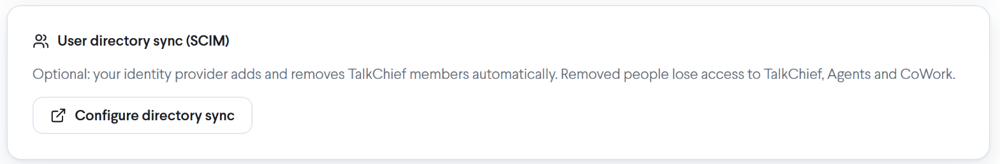
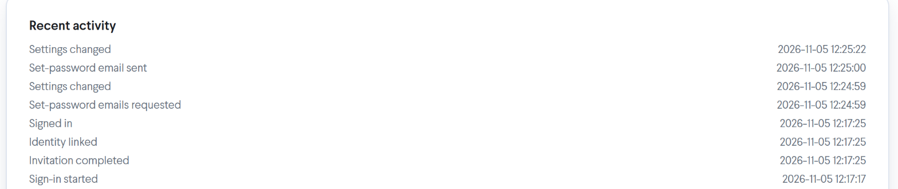

Once TalkChief single sign-on is running, you manage it from **Settings** > **Single sign-on**. This page covers what happens when you turn single sign-on off, how to remove someone's access for good, how directory sync (SCIM) keeps your team in step with your identity provider, what changes for phones, and what each **Recent activity** entry means. To set single sign-on up, see the [overview](/security/sso-overview) and the [Okta guide](/security/sso-okta).

## Turn off single sign-on

To turn single sign-on off, turn off **Use single sign-on** under **Sign-in options**.

Some of your members may have joined through single sign-on and never set a TalkChief password. When that is the case, TalkChief asks you to confirm with **Turn off single sign-on?**:

> N members who joined through single sign-on will get an email to set a TalkChief password. Everyone else signs in with their password as before.

Select **Turn off single sign-on** to go ahead.

- Those members are emailed a link to set a TalkChief password automatically. You don't need to send anything yourself.
- Everyone who already has a TalkChief password keeps signing in with it, as before.
- If you turn single sign-on back on before the email goes out, nothing is sent.

The same happens if your company leaves the **Professional** plan: members who only ever signed in through single sign-on get an email to set a TalkChief password.

**Recent activity** shows **Set-password emails requested** when you confirm, **Set-password email sent** for each email, and **Password set after single sign-on** when a member sets their password.

## Remove someone's access

### Passwords while single sign-on is required

While **Require single sign-on** is on, members on your verified domains have no TalkChief password to manage. TalkChief hides **Forgot password?** on the login page, **Change password** in their settings, and **Reset password** for them in **Teams & Members**. The company owner keeps these while **Owner keeps password access** is on.

### Deactivate a member in TalkChief

When you deactivate a member in TalkChief, they can't sign in, even if they are still active in your identity provider. Their sign-in is refused with: "This account can’t sign in right now. Contact your admin." **Recent activity** shows **Sign-in refused: account inactive**.

### Remove them in your identity provider

Unassign the person from the TalkChief app in your identity provider, or remove them from your directory. With directory sync connected, your identity provider tells TalkChief straight away: TalkChief switches the member off and signs them out of TalkChief, AI Voice Agents and CoWork. **Recent activity** shows **Member switched off by the directory**.

<Warning>
  Deleting a member in TalkChief does not remove them from your identity provider. If **Create accounts on first sign-in** is on and the person is still assigned to the TalkChief app in your identity provider, their next single sign-on creates a new TalkChief account for them and adds a seat back to your subscription. To remove someone for good, also unassign them in your identity provider, or use directory sync, which does it automatically.
</Warning>

## Directory sync (SCIM)

Directory sync is optional. With it connected, your identity provider adds and removes TalkChief members automatically: people you add to the TalkChief app get a member, and people you remove lose access to TalkChief, AI Voice Agents and CoWork.

<Frame>
  
</Frame>

To connect it, select **Configure directory sync** under **User directory sync (SCIM)** and follow the setup page that opens. When the connection is ready, **Recent activity** shows **Directory sync connected**.

Directory sync never switches off the company owner or an AI agent. When your directory asks for that, **Recent activity** shows **Directory change skipped (owner or AI agent)** and nothing changes.

## Phones when single sign-on is required

While **Require single sign-on** is on, a member's first sign-in through your identity provider gives the Web Phone a new calling password automatically. The Web Phone picks it up on its own, so the member doesn't need to do anything. **Recent activity** shows **Calling password renewed**.

Desk phones (Yealink, Cisco and others) and any other devices you set up keep their settings and keep working. You don't need to reconfigure them.

## Recent activity

**Recent activity**, at the bottom of **Settings** > **Single sign-on**, lists setup changes and sign-ins with the date and time of each, newest first.

<Frame>
  
</Frame>

### Sign-ins

| Entry | What it means |
| --- | --- |
| **Sign-in started** | Someone started a single sign-on and was sent to your identity provider. |
| **Signed in** | The sign-in finished and the person is signed in to TalkChief. |
| **Sign-in failed** | The sign-in didn't complete. The person sees "Company sign-in didn’t complete. Please try again." or "The sign-in link expired. Please start again." |
| **Identity provider refused sign-in** | Your identity provider didn't let the person through. Check that they are assigned to the TalkChief app there. |
| **Sign-in refused: account inactive** | The member is deactivated in TalkChief. |
| **Sign-in refused: no TalkChief account** | The person has no account or invitation, and **Create accounts on first sign-in** is off. |
| **Sign-in refused: no seat could be added** | **Create accounts on first sign-in** is on, but no seat could be added to your subscription for the new account, for example because the subscription has ended. |
| **Sign-in refused: email domain not verified** | The person's email domain isn't verified under **Email domains**. |
| **Sign-in refused: member of another company** | The email belongs to a member of a different TalkChief company. |

### Members and invitations

| Entry | What it means |
| --- | --- |
| **Identity linked** | An existing member signed in through your identity provider for the first time and was linked by email. |
| **Invitation completed** | An invited person signed in through your identity provider and their account is ready. |
| **Account created on first sign-in** | **Create accounts on first sign-in** created a new account. |
| **Calling password renewed** | A member's Web Phone got a new calling password because single sign-on is required. |
| **Member switched off by the directory** | Directory sync removed or deactivated the member. |
| **Member switched back on by the directory** | Directory sync reactivated the member. |
| **Directory could not create an account** | Directory sync asked for a new member, but TalkChief couldn't create the account. |
| **Directory change skipped (owner or AI agent)** | Directory sync tried to change the company owner or an AI agent, and TalkChief left them as they were. |

### Setup and settings

| Entry | What it means |
| --- | --- |
| **Single sign-on set up** | The connection to your identity provider was created. |
| **Domain added**, **Domain verified**, **Domain removed** | An email domain was added, passed the DNS TXT check, or was removed. |
| **Directory sync connected** | Directory sync was connected. |
| **Settings changed** | Someone changed a sign-in option, such as **Use single sign-on** or **Require single sign-on**. |
| **Identity provider certificate expiring** | The signing certificate from your identity provider expires soon. |
| **Set-password emails requested** | Single sign-on was turned off, and TalkChief queued set-password emails for members without a password. |
| **Set-password email sent** | One of those emails was sent. |
| **Password set after single sign-on** | A member set a TalkChief password from that email. |

## Troubleshooting

For what each sign-in message means and how to fix it, see [Troubleshooting](/security/sso-okta#troubleshooting) in the Okta guide. The messages are the same for every identity provider.
