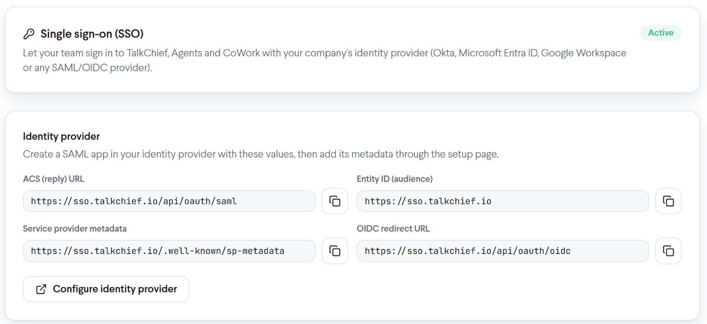
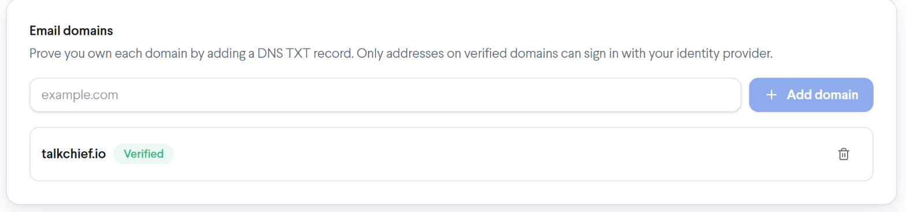
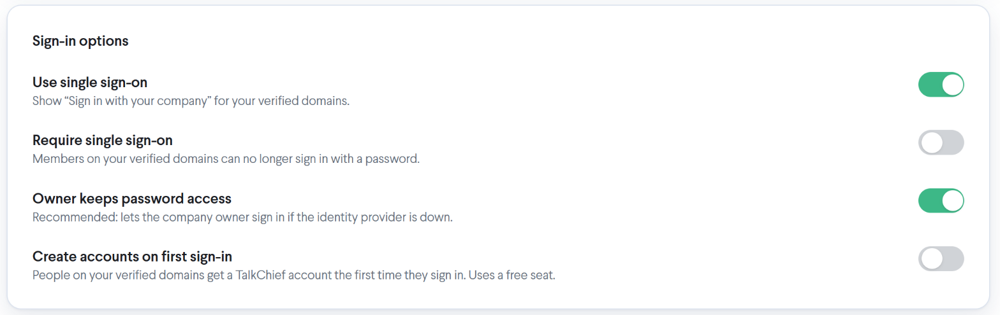
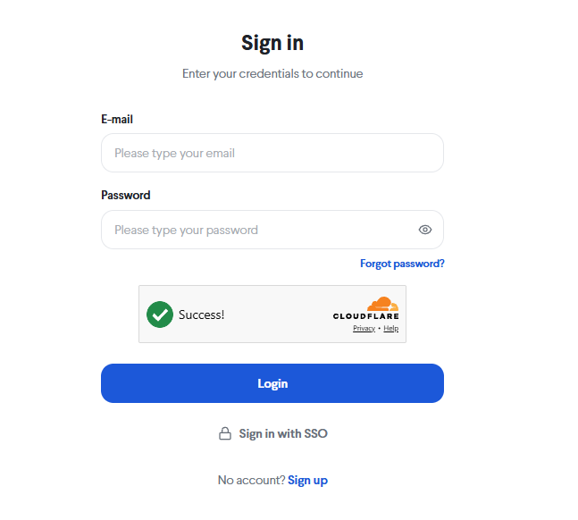
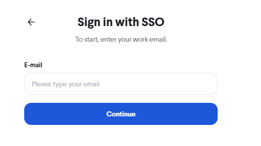

TalkChief single sign-on (SSO) lets your team sign in to TalkChief, Agents and CoWork with their company account from your identity provider, instead of a TalkChief password. This guide connects Okta over SAML: you create a TalkChief app in Okta, add its metadata to TalkChief, verify your email domain, and turn sign-in on.

<Info>
  Single sign-on is available on the **Professional** plan. You need a TalkChief admin account, an Okta admin account, and access to your domain's DNS settings.
</Info>

## How it works

Once SSO is on, people on your verified email domains see a **Sign in with your company** option on the TalkChief login page. TalkChief sends them to Okta, Okta confirms who they are, and they come back signed in. Okta controls who can sign in: only people assigned to the TalkChief app in Okta get through.

The first time an existing TalkChief member signs in through Okta, TalkChief links their Okta account to their member by email address. Their extension, numbers, devices and history stay as they are.

## Step 1: Start the setup in TalkChief

<Steps>
  <Step title="Open Single sign-on">
    In the TalkChief web app, go to **Settings** and select **Single sign-on**.
  </Step>
  <Step title="Create the connection">
    Select **Set up single sign-on**. The page now shows **Identity provider** with the values Okta needs. Keep this page open.
  </Step>
</Steps>

You will copy these values into Okta:

| TalkChief field | Value |
| --- | --- |
| **ACS (reply) URL** | `https://sso.talkchief.io/api/oauth/saml` |
| **Entity ID (audience)** | `https://sso.talkchief.io` |
| **Service provider metadata** | `https://sso.talkchief.io/.well-known/sp-metadata` |

Each field has a **Copy** button.

<Frame>
   Single sign-on with the Identity provider card showing the ACS (reply) URL, Entity ID (audience), Service provider metadata and OIDC redirect URL, each with a copy button, and the Configure identity provider button"
  />
</Frame>

## Step 2: Create the TalkChief app in Okta

<Steps>
  <Step title="Create a SAML app">
    In the Okta Admin Console, go to **Applications** > **Applications** and select **Create App Integration**. Choose **SAML 2.0** and select **Next**.
  </Step>
  <Step title="Name the app">
    Enter an **App name**, for example `TalkChief`, and select **Next**.
  </Step>
  <Step title="Enter the SAML settings">
    Under **SAML Settings**, set:

    - **Single sign-on URL**: the **ACS (reply) URL** from TalkChief. Leave **Use this for Recipient URL and Destination URL** selected.
    - **Audience URI (SP Entity ID)**: the **Entity ID (audience)** from TalkChief.
    - **Name ID format**: `EmailAddress`.
    - **Application username**: `Email`.
  </Step>
  <Step title="Sign the requests">
    Select **Show Advanced Settings**. Keep **Response** and **Assertion Signature** signed with **RSA-SHA256**. Under **Signature Certificate**, upload the TalkChief signing certificate from `https://sso.talkchief.io/.well-known/saml.cer`, then turn on **Signed Requests**. Okta then accepts only sign-in requests that really come from TalkChief.
  </Step>
  <Step title="Add the attribute statements">
    Under **Attribute Statements**, add:

    | Name | Value |
    | --- | --- |
    | `email` | `user.profile.email` |
    | `firstName` | `user.profile.firstName` |
    | `lastName` | `user.profile.lastName` |

    Select **Next**, choose **I'm an Okta customer adding an internal app**, and select **Finish**.
  </Step>
  <Step title="Assign people">
    On the app's **Assignments** tab, assign the people or groups who should sign in to TalkChief.
  </Step>
  <Step title="Copy the metadata URL">
    On the app's **Sign On** tab, copy the **Metadata URL**.
  </Step>
</Steps>

## Step 3: Add Okta's metadata to TalkChief

<Steps>
  <Step title="Open the setup page">
    Back on **Settings** > **Single sign-on**, select **Configure identity provider**. The identity provider setup page opens in a new tab.
  </Step>
  <Step title="Choose Okta">
    Select **Okta SAML SSO**. The first steps repeat the Okta settings above; select **Next Step** until you reach **Create SAML Connection**.
  </Step>
  <Step title="Save the connection">
    Paste the Okta **Metadata URL** into **Metadata URL** and select **Save**. The connection is listed as **Okta SAML** with the status **Active**.
  </Step>
</Steps>

## Step 4: Verify your email domain

Only addresses on a verified domain can sign in through Okta. You prove you own the domain with a DNS TXT record.

<Steps>
  <Step title="Add the domain">
    Under **Email domains**, enter your domain, for example `example.com`, and select **Add domain**. The domain shows **Waiting for DNS** with a **TXT record name** and a **TXT record value**.
  </Step>
  <Step title="Create the TXT record">
    In your DNS provider, create a TXT record with that name (for example `_talkchief-verify.example.com`) and that value.
  </Step>
  <Step title="Verify">
    Select **Verify**. When TalkChief finds the record, the domain shows **Verified**. If it says **The TXT record wasn't found yet**, wait a few minutes for DNS to update and select **Verify** again.
  </Step>
</Steps>

<Frame>
  
</Frame>

Add each email domain your team uses. You can remove a domain later with **Remove domain**.

## Step 5: Choose the sign-in options

Under **Sign-in options**:

<Frame>
  
</Frame>

| Option | What it does |
| --- | --- |
| **Use single sign-on** | Shows **Sign in with your company** for your verified domains. Turn this on to start. |
| **Require single sign-on** | Members on your verified domains can no longer sign in with a password. |
| **Owner keeps password access** | Lets the company owner sign in with a password if Okta is unavailable. Recommended. |
| **Create accounts on first sign-in** | People assigned in Okta get a TalkChief account the first time they sign in. Each new account adds a seat to your subscription, billed like an invitation. |

When **Use single sign-on** is on, the status at the top of the page changes from **Not active** to **Active**.

<Tip>
  Turn on **Use single sign-on** first and test with your own account. Turn on **Require single sign-on** only after your team has signed in through Okta, and keep **Owner keeps password access** on.
</Tip>

### Phones when single sign-on is required

The first time a member signs in through Okta while **Require single sign-on** is on, TalkChief gives the Web Phone a new calling password automatically, and the Web Phone picks it up on its own. Desk phones and any other phones you set up keep working with their current settings: you don't need to reconfigure them.

**Recent activity** at the bottom of the page lists setup changes and sign-ins, such as **Domain verified**, **Identity linked** and **Signed in**. [Manage single sign-on](/security/sso-manage#recent-activity) explains every entry.

## Invite people on your domain

When you invite a member whose email is on a verified domain, the invitation asks them to sign in with their company account. Its **Sign in with SSO** button opens the TalkChief login page on the single sign-on step with their email filled in. While **Require single sign-on** is off, the invitation also offers to set a TalkChief password instead. When it is on, there is no password option.

The first time the invited person signs in through Okta, their TalkChief account is ready: their extension and phones are set up as with any invitation.

## Sign in with Okta

<Steps>
  <Step title="Open the login page">
    Go to the TalkChief login page and select **Sign in with SSO**, under the **Login** button.

    <Frame>
      
    </Frame>
  </Step>
  <Step title="Enter your work email">
    On **Sign in with SSO**, enter your work email and select **Continue**. TalkChief sends you to Okta.

    <Frame>
      
    </Frame>
  </Step>
  <Step title="Sign in to Okta">
    Sign in to Okta if you aren't already. You return to TalkChief, signed in.
  </Step>
</Steps>

You can also type your work email in the normal login form: on a verified domain, **Sign in with your company** appears under it.

From TalkChief, the **CoWork** and **AI Voice Agents** links in the sidebar open those apps with the same sign-in.

To sign in to CoWork on the web, go to [cowork.talkchief.io](https://cowork.talkchief.io) and select **Sign in with SSO** on the login page.

## Troubleshooting

<AccordionGroup>
  <Accordion title='"Single sign-on isn’t set up for this email."'>
    The email's domain isn't verified for SSO, or **Use single sign-on** is off. Check **Email domains** and **Sign-in options** on **Settings** > **Single sign-on**, or sign in with your password.
  </Accordion>
  <Accordion title='"There’s no TalkChief account for you yet."'>
    You are assigned in Okta but have no TalkChief account, and **Create accounts on first sign-in** is off. Ask your TalkChief admin to invite you or to turn that option on.
  </Accordion>
  <Accordion title='"Your company’s TalkChief subscription can’t take a new member right now."'>
    **Create accounts on first sign-in** adds a seat to your company's subscription for each new account, and that seat couldn't be added, for example because the subscription has ended. Ask your admin to check the company's subscription.
  </Accordion>
  <Accordion title='"Your company signs in with single sign-on."'>
    **Require single sign-on** is on for your domain, so password sign-in is refused. Use **Sign in with SSO**.
  </Accordion>
  <Accordion title='"The sign-in link expired. Please start again."'>
    The sign-in took too long or was started in another tab. Go back to the login page and start again.
  </Accordion>
  <Accordion title='"Company sign-in didn’t complete. Please try again."'>
    Okta didn't finish the sign-in. Check that you are assigned to the TalkChief app in Okta and that its **Single sign-on URL** and **Audience URI** match the values in TalkChief exactly.
  </Accordion>
  <Accordion title='"Your email domain isn’t set up for company sign-in."'>
    Your email domain isn't verified under **Email domains**. Ask your admin to add and verify it on **Settings** > **Single sign-on**.
  </Accordion>
  <Accordion title='"This account can’t sign in right now. Contact your admin."'>
    Your TalkChief member is deactivated, so sign-in is refused even though Okta let you through. Ask your TalkChief admin to reactivate you. See [Remove someone's access](/security/sso-manage#remove-someones-access).
  </Accordion>
</AccordionGroup>

To turn single sign-on off, remove members, or connect directory sync, see [Manage single sign-on](/security/sso-manage).
