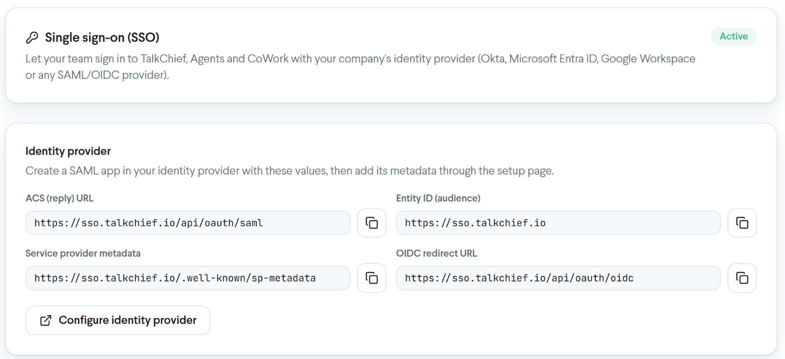
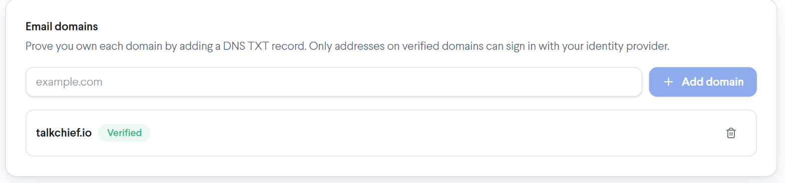
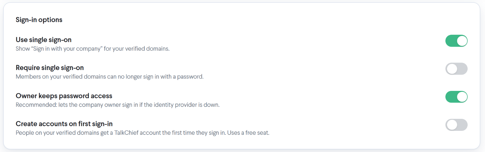
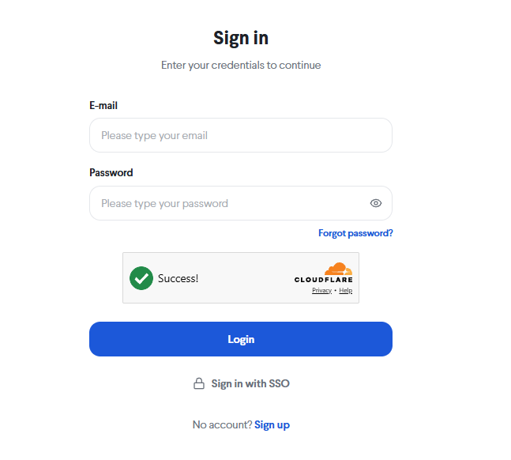
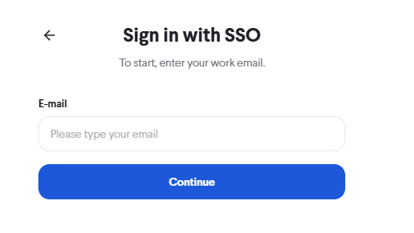

TalkChief single sign-on (SSO) lets your team sign in to TalkChief, AI Voice Agents and CoWork with their company account from your identity provider, so nobody needs a separate TalkChief password. This page explains how single sign-on works, which identity providers you can use, what each sign-in option does, and what happens to existing members and new invitations once it is on.

<Info>
  Single sign-on is available on the **Professional** plan. To set it up you need a TalkChief admin account, an admin account in your identity provider, and access to your domain's DNS settings.
</Info>

## What single sign-on does

Once single sign-on is on, people on your verified email domains sign in through your identity provider instead of typing a TalkChief password. Your identity provider confirms who they are and sends them back to TalkChief, signed in. The same company sign-in works for:

- The TalkChief web app
- AI Voice Agents
- CoWork on the web

Your identity provider decides who can sign in. Only people you assign to the TalkChief app in your identity provider get through.

You manage everything on **Settings** > **Single sign-on** in the TalkChief web app. The status at the top of the page shows **Active** once single sign-on is on.

<Frame>
   Single sign-on with the Active status badge and the Identity provider card showing the ACS (reply) URL, Entity ID (audience), Service provider metadata and OIDC redirect URL with copy buttons and the Configure identity provider button" />
</Frame>

## Supported identity providers

You can connect any identity provider that supports **SAML 2.0** or **OIDC**, including:

| Identity provider | How to connect |
| --- | --- |
| **Okta** | Follow the step-by-step guide: [Set up single sign-on with Okta](/security/sso-okta). |
| **Microsoft Entra ID** | Create a SAML app in Entra ID with the values below, then add its metadata through **Configure identity provider**. |
| **Google Workspace** | Create a custom SAML app in Google Workspace with the values below, then add its metadata through **Configure identity provider**. |
| **Any other SAML 2.0 or OIDC provider** | Same steps: create an app with the values below and add its metadata or OIDC details through **Configure identity provider**. |

The **Identity provider** card on **Settings** > **Single sign-on** shows the values your identity provider needs. Each one has a copy button.

| TalkChief field | Value | Use it for |
| --- | --- | --- |
| **ACS (reply) URL** | `https://sso.talkchief.io/api/oauth/saml` | SAML: the single sign-on, reply or ACS URL |
| **Entity ID (audience)** | `https://sso.talkchief.io` | SAML: the audience or SP entity ID |
| **Service provider metadata** | `https://sso.talkchief.io/.well-known/sp-metadata` | SAML: providers that can import service provider metadata |
| **OIDC redirect URL** | `https://sso.talkchief.io/api/oauth/oidc` | OIDC: the redirect (callback) URL |

## Set up single sign-on

Setting up takes five steps. The [Okta guide](/security/sso-okta) walks through each one with Okta's screens; other identity providers follow the same order.

<Steps>
  <Step title="Start the setup in TalkChief">
    Go to **Settings** > **Single sign-on** and select **Set up single sign-on**. The **Identity provider** card appears with the values above.
  </Step>
  <Step title="Create the TalkChief app in your identity provider">
    Create a SAML or OIDC app with those values, and assign the people or groups who should sign in to TalkChief.
  </Step>
  <Step title="Add your identity provider's details to TalkChief">
    Select **Configure identity provider**. The setup page opens in a new tab. Add your identity provider's metadata there and save the connection.
  </Step>
  <Step title="Verify your email domain">
    Under **Email domains**, add your domain and create the DNS TXT record TalkChief shows you. Select **Verify**. Only addresses on a verified domain can sign in through your identity provider.
  </Step>
  <Step title="Turn on single sign-on">
    At the top of the page, turn on **Use single sign-on**. Test with your own account before you require it for everyone.
  </Step>
</Steps>

<Frame>
  
</Frame>

## Sign-in options

The **Sign-in options** card controls how single sign-on behaves for your company.

<Frame>
  
</Frame>

| Option | What it does |
| --- | --- |
| **Use single sign-on** | The main switch, at the top of the page. Shows **Sign in with your company** for your verified domains. People can still use their password unless you also require single sign-on. Turning it off also turns off **Require single sign-on**. |
| **Require single sign-on** | Members on your verified domains can no longer sign in with a password. They must use your identity provider, and TalkChief hides **Forgot password?** and **Change password** for them. |
| **Owner keeps password access** | Lets the company owner sign in with a password if the identity provider is down. Recommended. |
| **Create accounts on first sign-in** | People on your verified domains get a TalkChief account the first time they sign in, even if nobody invited them. Each new account adds a seat to your subscription, billed like an invitation. |

<Tip>
  Turn on **Use single sign-on** first and sign in with your own account. Turn on **Require single sign-on** only after your team has signed in through your identity provider, and keep **Owner keeps password access** on.
</Tip>

To turn single sign-on off again, see [Turn off single sign-on](/security/sso-manage#turn-off-single-sign-on).

## How existing members are linked

You don't need to recreate your team. The first time an existing member signs in through your identity provider, TalkChief links their company account to their TalkChief member by email address, as long as the email is on a verified domain. Their extension, numbers, devices and call history stay as they are.

**Recent activity** on the settings page records this as **Identity linked**. From then on, the member signs in through your identity provider.

## Invitations on a single sign-on domain

When you invite someone whose email is on a verified domain, the invitation email asks them to sign in with their company account. Its **Sign in with SSO** button opens the TalkChief login page on the single sign-on step with their email already filled in.

- While **Require single sign-on** is off, the invitation also offers to set a TalkChief password instead.
- When **Require single sign-on** is on, there is no password option.

The first time the invited person signs in through your identity provider, their account is ready: their extension and phones are set up as with any invitation. **Recent activity** shows **Invitation completed**.

## Create accounts on first sign-in

With **Create accounts on first sign-in** off, only people who already have a TalkChief account, or who have an invitation, can sign in. Anyone else assigned in your identity provider sees: "There’s no TalkChief account for you yet. Ask your TalkChief admin to invite you."

With it on, anyone on your verified domains who is assigned to the TalkChief app in your identity provider gets a TalkChief account the first time they sign in. Each new account adds one seat to your subscription and is billed like an invitation, just as when you add a member yourself. Deleting the member removes the seat. If a seat can't be added, for example because the subscription has ended, the person sees: "Your company's TalkChief subscription can't take a new member right now. Ask your admin."

## How your team signs in

On the TalkChief login page, **Sign in with SSO** sits under the password form.

<Frame>
  
</Frame>

<Steps>
  <Step title="Open the single sign-on step">
    On the TalkChief login page, select **Sign in with SSO**.
  </Step>
  <Step title="Enter your work email">
    Enter your work email and select **Continue**. TalkChief sends you to your identity provider.
  </Step>
  <Step title="Sign in with your company account">
    Sign in to your identity provider if you aren't already. You come back to TalkChief, signed in.
  </Step>
</Steps>

<Frame>
  
</Frame>

You can also type your work email in the normal login form: on a verified domain, **Sign in with your company** appears under it.

From TalkChief, the **CoWork** and **AI Voice Agents** links in the sidebar open those apps with the same sign-in. To sign in to CoWork directly, go to [cowork.talkchief.io](https://cowork.talkchief.io) and select **Sign in with SSO** on the login page.

## Next steps

<Columns cols={2}>
  <Card title="Set up SSO with Okta" icon="shield-halved" href="/security/sso-okta">
    Connect Okta over SAML, step by step, with troubleshooting for the sign-in messages.
  </Card>
  <Card title="Manage single sign-on" icon="sliders" href="/security/sso-manage">
    Turn single sign-on off, remove members, use directory sync, and read Recent activity.
  </Card>
</Columns>
